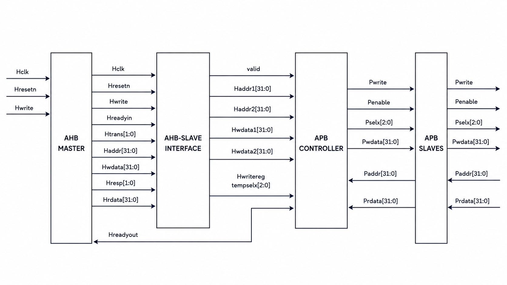

# AHB to APB Bridge using Verilog HDL

An AMBA AHB-to-APB bridge written in Verilog HDL. The bridge connects a high-performance AHB master to low-speed APB peripherals by converting AHB transfers into APB transfers, with address decoding to select the target peripheral.

## Architecture



The design has three main blocks:

| Block | File | Role |
|---|---|---|
| AHB Slave Interface | `rtl/AHB_slave.v` | Captures AHB address, control and write data; pipelines them and decodes the peripheral select |
| APB Controller | `rtl/APB_controller.v` | FSM that generates APB control signals (`PSEL`, `PENABLE`, `PWRITE`) and handles ready/response back to AHB |
| APB Interface | `rtl/APB_interface.v` | Drives address, write data and select lines to the APB peripherals and returns read data |

`rtl/Bridge_top.v` integrates all three blocks, and `rtl/AHB_Master.v` is the AHB master model used to drive the bridge in simulation.

## Features

- AHB slave interface with pipelined address/data capture
- APB controller implemented as a finite state machine
- Address decoding for multiple APB peripherals
- Single write, single read and burst write transfers
- Modular design with a dedicated testbench for each block and transfer type

## Address Decoding

| Address range | Peripheral select |
|---|---|
| `0x8000_0000` - `0x83FF_FFFF` | Peripheral 1 |
| `0x8400_0000` - `0x87FF_FFFF` | Peripheral 2 |
| `0x8800_0000` - `0x8BFF_FFFF` | Peripheral 3 |

## Repository Structure

```
AHB-TO-APB-BRIDGE/
├── rtl/
│   ├── AHB_Master.v
│   ├── AHB_slave.v
│   ├── APB_controller.v
│   ├── APB_interface.v
│   └── Bridge_top.v
├── tb/
│   ├── tb_top.v
│   ├── tb1_ahb_interface.v
│   ├── tb2_apb_controller.v
│   ├── tb3_single_write.v
│   ├── tb4_single_read.v
│   └── tb5_burst_write.v
├── waveforms/
├── Architecture.png
└── README.md
```

## Tools Used

- Verilog HDL
- Intel Quartus Prime
- ModelSim

## How to Simulate

From the repository root, using ModelSim:

```
vlib work
vlog rtl/*.v tb/*.v
vsim -c work.tb_top -do "run -all; quit"
```

To run an individual testbench, replace `tb_top` with its module name (for example `tb3_single_write`). For waveforms, drop the `-c` flag and run `add wave -r /*` followed by `run -all` in the GUI.

## Verification

Each testbench targets one part of the design:

| Testbench | What it verifies |
|---|---|
| `tb1_ahb_interface.v` | AHB slave interface: address/data capture and peripheral select |
| `tb2_apb_controller.v` | APB controller FSM state transitions and control signals |
| `tb3_single_write.v` | Single AHB write converted to an APB write |
| `tb4_single_read.v` | Single AHB read returning APB read data |
| `tb5_burst_write.v` | Burst of AHB writes converted to consecutive APB writes |
| `tb_top.v` | Top-level integration of the full bridge |

Simulation waveforms are in the [`waveforms`](waveforms/) folder.

## Applications

- SoC design with AMBA-based interconnects
- Embedded systems with mixed high-speed and low-speed peripherals
- Digital IC and VLSI design projects

## Future Improvements

- Burst read support
- Error response handling
- Support for more APB peripherals
- Performance optimization

## Author

Sriya Hasini M, B.Tech ECE (VLSI), VIT-AP University
